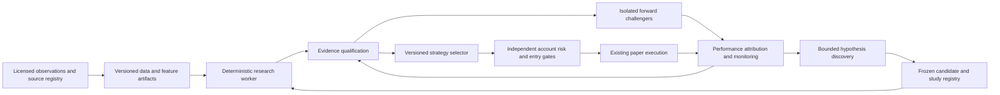

# TradingPilot strategy intelligence: research and build plan

Prepared 16 October 2026, India time. Source checkout reviewed: `f83ca65`.

This is a proposed architecture and delivery plan, not a claim that these capabilities are implemented or that a profitable strategy has been found. The target is an auditable research-to-selection system that can improve its decisions as evidence arrives. There is no defensible public ranking of the world's best private trading systems, and their proprietary data, strategies and controls cannot be recovered from marketing pages. The benchmarks below are leading documented examples, not a returns leaderboard.

## 1. Recommendation

Build on the existing modular Python application rather than replace it with a research framework. Separate four decisions: whether evidence is usable, whether a strategy qualifies, which qualified strategy fits the account now, and whether an entry is executable. AI can assist research and explanation; deterministic code owns calculations and gates.

The most important additions are:

1. A licensed, revision-aware data and artifact registry with separate event time and availability time.
2. More realistic, versioned execution/cost/capital models and full marked account-equity reporting.
3. Separately protected holdouts and search accounting that cannot be reset by renaming an experiment family.
4. A reproducible NIFTY options research adapter, distinct from the current registered equity adapter and the existing daily options replay.
5. A tested, conservative strategy-selection policy with an explicit no-trade option.
6. Prospective challenger portfolios, reliable job execution, drift monitoring and reviewed promotion/rollback.

Daily evaluation is desirable. Daily replacement is not the objective. Initially, learning can improve exclusion rules, cost estimates and evidence quality while the incumbent strategy remains unchanged.

## 2. What the external evidence supports

The distinction between a documented mechanism, a research backtest, a vendor statement and verified live performance matters. No inspected source establishes that an autonomous, daily-changing NIFTY options selector reliably produces profits. No private institutional trading engine was inspected or executed during this research.

| Benchmark | Documented strength | What to borrow | Limit or adaptation |
|---|---|---|---|
| Microsoft RD-Agent-Quant | Hypothesis, implementation, evaluation and feedback workflow with reported research experiments | Structured research proposals, retained feedback and bounded candidate generation | Its paper notes batch adaptation limits. Reported market experiments do not establish NIFTY applicability or audited live performance. [Paper](https://arxiv.org/html/2505.15155v2) |
| Microsoft Qlib | Rolling tasks, model selection for serving and active-model history | Frozen experiments and explicit history of active versions | Keep our execution engine; Qlib's default data and assumptions are not an Indian options archive. [Online workflow](https://qlib.readthedocs.io/en/latest/component/online.html) |
| QuantConnect / LEAN | Walk-forward optimization and modular fill/slippage modeling | Chronological evaluation and independently testable reality models | Optimizing more frequently introduces tradeoffs; a platform capability is not a strategy result. [Walk-forward](https://www.quantconnect.com/docs/v2/writing-algorithms/optimization/walk-forward-optimization), [fills](https://www.quantconnect.com/docs/v2/writing-algorithms/reality-modeling/trade-fills/key-concepts) |
| NautilusTrader | Shared strategy code across backtest/live and explicit reconciliation concerns | Shared decision semantics, durable state and recovery tests | Sharing code does not reproduce venue timing or prove account isolation. No runtime replacement is proposed. [Live concepts](https://nautilustrader.io/docs/latest/concepts/live/) |
| HftBacktest | Depth/queue and partial-fill simulation with explicit replay limits | Conservative size/latency assumptions and measurement of simulation discrepancies | Replayed orders do not change the market. Queue models cannot compensate for absent order-book evidence. [Fill assumptions](https://hftbacktest.readthedocs.io/en/latest/order_fill.html) |
| Numerai | Prospective signal scoring and measurement of contribution to an aggregate model | Forward evidence and incremental portfolio contribution, not just standalone rankings | Its targets and infrastructure differ from a NIFTY paper account. No token purchase or participation is needed. [Scoring](https://docs.numer.ai/numerai-tournament/scoring) |
| FreqAI | Retraining cadence, persisted predictions and stale-model controls | Prediction history, expiry checks and recovery patterns | Documentation calls its continual-learning implementation experimental and highlights overfitting risk. Do not automatically replace our incumbent with the newest model. [Operations](https://www.freqtrade.io/en/stable/freqai-running/) |
| Two Sigma public research | Highlights research discipline and the limits of AI-driven finance | Treat AI-generated hypotheses as additional multiple testing; investigate pretrained-model historical knowledge leakage | Public commentary is evidence of stated practice, not access to its proprietary system or verified returns. [2026 outlook](https://www.twosigma.com/articles/ai-in-investment-management-2026-outlook-part-ii/) |
| Man Group / AHL public execution research | Studies combined costs across successive trades | Evaluate turnover and execution effects at portfolio level | Institutional execution models require data and calibration we do not yet have. [Cost research](https://www.man.com/insights/counting-the-costs) |
| Feast | Point-in-time feature retrieval | Availability-aware feature joins and bounded feature age | Event time alone is insufficient. Current docs explain how corrected/backfilled values can leak unless creation time is also constrained. Adopt the semantics before considering a feature-store dependency. [Point-in-time joins](https://docs.feast.dev/getting-started/concepts/point-in-time-joins) |
| MLflow | Versioned registry, aliases and controlled environments | Explicit champion/challenger identity and promotion history | A mutable alias can silently change the next inference. Pin versions in every recommendation and deployment; an alias is not an approval policy. [Registry workflow](https://www.mlflow.org/docs/latest/ml/model-registry/workflow/) |
| TradingView | Accessible strategy reports with disclosed simulation assumptions and historical bar detail | A concise report with inputs, fills and costs available behind details | OHLC simulation still assumes intrabar paths; higher detail is not automatically tick/depth realism. [Strategy documentation](https://www.tradingview.com/pine-script-docs/concepts/strategies/) |
| Bailey / Lopez de Prado and coauthors | Methods addressing selection bias, repeated testing and non-normal returns | Retain the entire search history; use appropriate statistical diagnostics | Deflated Sharpe and probability-of-backtest-overfitting methods have assumptions and are not profit guarantees. [DSR paper](https://www.davidhbailey.com/dhbpapers/deflated-sharpe.pdf), [PBO paper](https://www.davidhbailey.com/dhbpapers/backtest-prob.pdf) |

Reuse policy: prefer concepts and small adapters first. Review the exact version's license, dependencies and dataset rights before copying code or integrating a library. Prior Qlib artifact inspection and MIT notice are recorded under `third_party/qlib`; that inspection did not validate trading profitability. No new upstream package was installed or executed for this plan. REA is appropriate for shipped artifacts, not a substitute for reading an available source repository. Graphify still indexes `c24ea1b`, behind the reviewed checkout; current-source reads underpin the gap assessment.

## 3. Current implementation: strengths and material gaps

The existing work is useful groundwork, not an autonomous investment engine. The reviewed sources include the registry, budget, input, rolling-planner and registered-evaluator modules; equity and options replay code; strategy-fit/ranking modules; probability and cost notes; and the latest deployed UI evidence.

| Area | Present evidence | Missing acceptance or improvement |
|---|---|---|
| Candidate/trial history | Frozen service definitions/manifests, retained failed outcomes and separate engine/operator results | Source/license review, reviewed hypothesis-to-rule mapping and complete experiment lineage |
| Search budgets | Durable numbered slots across candidates within one named account/family | Canonical study identity and parent/global resource budgets; renaming a family can currently start another allowance |
| Data integrity | Exact byte/code hashes, bounded inputs, OHLC and chronological checks | Hashes prove identity, not authenticity, rights, point-in-time correctness or completeness |
| Holdout boundary | Replay receives bars only through validation end | The same raw JSON still contains the holdout, and validation code reads it. This is not a sealed or independently controlled holdout |
| Registered evaluator | Deterministic fixed equity rules, frozen settings and an isolated SQLite demo | A registered NIFTY options adapter and policy-matched historical evidence; generated hypotheses do not compile themselves into verified rules |
| Existing options replay | Historical expired-contract/daily-candle paths, strike/lot handling and explicit assumptions | Daily candles cannot establish executable intraday depth or stop/target ordering. Do not present it as the forward worker's exact execution history |
| Reproducibility | Declared source-set digest and partial environment metadata | Dependency/lockfile and image identity, input revision lineage, complete effective settings and reproducible clean-environment runs |
| Costs | Durable, versioned illustrative F&O charge snapshots; equity replay assumptions | Effective-date broker/exchange/tax assumptions, settlement/financing treatment, realistic execution and capital use. Never retrofit new costs as old recorded facts |
| Reporting | Configuration-separated descriptive reports, accounting linkage and exclusions | A full equity timeline including qualified open marks, capital movements, exposure, downtime and open-risk paths; marked drawdown remains distinct from closed-trade drawdown |
| Market context | Explicit descriptive trend/volatility/volume heuristics and ranking logic | No proof that a context-conditioned selector improves unseen results. These heuristics are not calibrated forecasts |
| Runtime research | Offline service flow, failure consumption and idempotent persisted results | Job leases, duplicate-compute prevention, cancellation/time/memory limits, restart recovery and PostgreSQL concurrency acceptance |
| Research UI | Read-only screens and isolated populated-card checks; rebuilt API candidate listing loads the account's empty state | Deployed populated evaluation joins, complete migration/runtime acceptance and a provenance review workflow |
| Forward learning | Existing paper observations and saved entry context | Separate challenger portfolios with frozen prospective predictions and eligible labels; existing sparse results cannot establish a reliable predictive probability |

Source anchors: `packages/regime/registered_evaluator.py`, `research_budget.py`, `research_inputs.py`, `research_identity.py`, `fixed_rule_evaluator.py`; `packages/backtesting/replay.py`; `packages/regime/strategy_fit.py`; `COST_MODEL.md`; `PROBABILITY_RESEARCH.md`.

## 4. Target architecture

Research workers receive no live-order capability and no access to the owner's account database beyond narrowly scoped research services. Paper execution receives approved, pinned definitions rather than arbitrary generated code. Promotion changes the version used for future decisions only; it must not alter open positions' saved policy.

Keep the current API, PostgreSQL and modular engine. Initially use a single bounded research worker and filesystem artifacts with database metadata. Separate data/holdout permissions where needed; do not introduce Kafka, Kubernetes, a vector database, MLflow and Feast merely because benchmark platforms use sophisticated infrastructure. Add a dependency only after a measured operational requirement exceeds the simpler implementation.

## 5. Data and execution evidence before advanced models

### 5.1 A revision-aware artifact registry

Each artifact needs provider, rights/restrictions, instrument and contract identity, covered period, acquisition time, hash, byte size, schema, quality report and parent revisions. Features need event time, first available time, local receipt time and calculation version. Corrections create a new revision; they do not silently rewrite history. Train on what was available at the simulated decision time, not what today's archive later corrected.

For equities, account for splits, dividends, delistings and historical universe membership. For NIFTY options, retain historical contract masters, actual expiry/lot/tick conventions, expired chains and the contemporaneous underlying reference. Current constituents and current lot sizes must not be projected backwards.

Maintain a capability matrix by provider: index OHLC, expired option OHLC, bid/ask/depth history, trade ticks, OI/IV availability, retention and usage rights. Missing historical depth means an indicative replay, not verified fills. No subscription purchase is assumed; any paid data decision needs a separate concrete capability/cost review.

### 5.2 Preserve timestamp uncertainty

Track message generation, receipt, last trade and book-observation/change times separately. A recently received unchanged book is not proof of when the exchange last changed it. A changing observed book establishes a local observation interval, not an invented exchange timestamp. The [Upstox V3 documentation](https://upstox.com/developer/api-documentation/v3/get-market-data-feed/) distinguishes message/tick timestamps, trade time and depth fields; it does not, by itself, settle our pending strict exchange-origin book-time question.

Use source-quality tiers with explicit capability flags rather than one vague freshness score. A change of provider or timestamp basis invalidates evidence equivalence unless reviewed. Preserve indicative-mode warnings while independent software research continues.

### 5.3 Version costs, fills and capital consistently

Keep existing illustrative models immutable. Add separate researched, effective-date cost versions with verified tariff sources and explicit unknowns. Include each leg, bid/ask spread once, order charges, applicable taxes/fees, settlement effects and financing where relevant. Separate observed costs from estimates and stress assumptions.

Replay conservative quantity and latency assumptions. Model rejects, unavailable quotes, insufficient depth and potential multi-leg timing risk rather than giving every signal a fill. Daily OHLC studies need an explicit same-bar ambiguity policy. Compare base, delayed-entry and wider-spread/cost-stress scenarios; choose scenarios before viewing final results.

Report risk against appropriate committed capital/margin, not just premium paid. Include portfolio exposure, simultaneous positions and adverse scenarios. An apparently high-return short-premium strategy can have poor tail behavior; a high win frequency cannot substitute for expected outcome and risk.

## 6. Research discipline and controlled adaptation

### 6.1 Freeze studies, not just individual runs

Create a canonical `StudyDefinition` containing objective, instrument universe, data snapshot, strategy family/lineage, allowed parameters/features, execution/cost model, training/validation/calibration/final-test policy, budgets and stopping rules. Add parent study and candidate IDs, external/manual experiments and the LLM/model/prompt/source versions used to propose hypotheses.

A new name must not reset the scientific search history. Retries should not masquerade as independent evidence. Failed and abandoned trials count against resource/search accounting. Review code and artifact changes before resuming a study rather than silently updating its fingerprint.

### 6.2 Protect evaluation boundaries

Use nested chronological development and evaluation. Fit transforms, feature selection, model tuning and calibration only on their permitted earlier windows. Purge overlapping labels using actual event/holding intervals; an arbitrary fixed gap alone does not prove isolation. Preserve adequate past-only warmup and declare carry/reset behavior at boundaries. Count discarded/censored/open outcomes and opportunity costs rather than hiding them.

Move the final holdout into a separate restricted artifact. Ordinary proposal/evaluation workers receive only approved development data. Log and authorize final-test access; once inspected, that period is no longer untouched for further optimization. New improvement waves eventually require new prospective data. Overlapping folds cannot be added up as independent observations.

AI introduces an additional leakage route: a pretrained model may know historical market events. Do not treat an LLM's historically generated news narrative as point-in-time forecasting evidence. Prefer timestamped source-only extraction and prospective tests. This risk is specifically raised in [Two Sigma's discussion](https://www.twosigma.com/articles/ai-in-investment-management-2026-outlook-part-ii/).

### 6.3 Evaluate robustness, not the single best backtest

Start with the frozen incumbent and a no-trade baseline under comparable capital and cost assumptions. Compare paired time periods and evaluate net expectancy, continuous marked drawdown, downside/tail exposure, turnover, time in market, parameter stability, regime coverage and dependence on a few exceptional trades. Use appropriate time/dependence-aware uncertainty estimates.

Track the complete search and use multiple-testing diagnostics where their assumptions/data requirements hold. DSR/PBO are additional diagnostics, not automatic pass buttons. Twenty closes per window is currently a display/review threshold, not proof of statistical significance, independence, calibration or deployability.

Evaluate each added feature by ablation against a simpler baseline. A more complex model must earn its extra costs and operational burden on later data. Prefer a stable parameter region to one isolated optimum. Retain honest negative findings.

### 6.4 Discovery and scheduling

Discover from a bounded allowlist of research papers, official documentation, licensed data sources and reviewed repositories. Deduplicate by underlying idea and implementation lineage, not paper title. Record author/source, publication and retrieval dates, applicable market, economic rationale, adaptation and license. Do not ingest private marketplace code or run arbitrary scraped programs.

Initially permit only existing typed rule adapters and small, predeclared parameter variations. A future rule-expression language must be bounded and validated; it should not use `eval`, unrestricted Python or allow model-generated code in the paper worker.

Suggested cadence is a proposal: daily data-quality/research-health checks and recommendation refresh; bounded weekly challenger batches; periodic reviewed promotion based on evidence maturity. Retrain only when data and diagnostics warrant it. Set account/study CPU, memory, runtime and API-cost limits. Paid model jobs remain disabled until separately authorized.

## 7. Linking research to strategy selection

The selector is itself a strategy and must undergo chronological and forward validation. Choosing whichever candidate performed best recently can introduce another layer of overfitting even when each individual candidate has a backtest.

### Stage 1: gate first

Reject or withhold a recommendation when source/data/cost qualifications fail, an artifact or prediction is stale, the policy is unrecognized, liquidity/session conditions fail, evidence is insufficient, or the account cannot fit the risk. Do not let a high numerical score compensate for a hard failure.

### Stage 2: compare qualified candidates conservatively

Start with a transparent rule-based selector using comparable out-of-sample evidence, risk and current observable context. Evaluate whether the candidate adds value to the account's existing exposure, not only standalone P&L. Avoid optimizing arbitrary score weights on the final test. Keep the incumbent when evidence is indistinguishable; abstain when no candidate qualifies. Add switching costs and minimum improvement/dwell rules to avoid unstable daily changes.

Later, a learned selector can estimate conditional outcomes with shrinkage and uncertainty, benchmarked against the frozen simple selector. Context such as trend, realized volatility, IV term structure/skew, days to expiry, spread, liquidity, session and scheduled events is useful only when timestamped, available and validated. More features are not automatically better.

### Stage 3: make the decision understandable

The default card should show one suggested strategy or `No qualified strategy`, its evidence status, three concise reasons, risk/capital requirement, key entry criteria and what is currently unmet. Expanded details should show versions, periods, sample size, costs, risk scenarios, alternatives, limitations and recommendation expiry.

Separate `research eligible`, `market fit`, `entry ready` and `account capacity`. This prevents a favorable strategy recommendation being confused with an immediately executable entry. A selection prepares the existing paper setup; it does not bypass entry checks or create a live broker order.

Persist a `RecommendationSnapshot` before the next outcome: exact candidate/selector versions, available features and their times, qualified alternatives, rejected reasons, account/risk snapshot, selected action or abstention, expiry and artifact hashes. This supports honest later attribution of the actual selection policy.

## 8. Probability, portfolio learning and forward evidence

### 8.1 Predict the right event

If a probability is eventually displayed, define the event and horizon: for example, positive net realized P&L under a specific entry/exit policy and cost model. Expiry payoff probability is not the same event as winning under a stop/target policy. Loss and flat are separate outcomes; unresolved trades are not automatically losses. Record censoring and mark-to-market separately.

Use chronological, disjoint model-fitting/calibration/evaluation windows and a simple base-rate baseline. Measure reliability, Brier score and log loss, including by policy and sufficiently supported regimes. The [scikit-learn calibration documentation](https://scikit-learn.org/stable/modules/calibration.html) explains why fitting the calibrator on biased training predictions is unsafe; ordinary random-fold defaults are not a time-series solution.

Withhold a percentage outside validated feature/policy support, during drift or with insufficient evidence. A model's verbal confidence, IV-based payoff approximation and historical win frequency must remain distinct. A strategy winning 80% of the time can still have negative expectancy: 0.8 × 100 minus 0.2 × 600 is -40 before any additional costs.

### 8.2 Forward challengers

Run a small number of frozen challengers in separate shadow portfolios, initially without changing the owner's positions. Persist predictions before outcomes and use the same eligible observations, execution assumptions and evaluation periods as the incumbent. Quarantine test, manual, replay, indicative-forward and qualified-forward evidence; do not pool them into one success statistic.

Evaluate incremental account contribution and correlation. Three similarly exposed strategies are not three independent edges. Portfolio risk must bound aggregate loss scenarios, concentration and sensitivity to volatility/underlying moves. More sophisticated allocation comes only after individual evidence is adequate.

### 8.3 Diagnose before adapting

Monitor data changes, unavailable/stale features, prediction calibration, execution discrepancies, costs and risk. Separate data failure, execution failure, selection failure and strategy failure. A bad feed should not trigger strategy retraining; a changed fee schedule should not rewrite old performance.

Use reviewed state transitions: `DRAFT → RESEARCHABLE → TESTED → FORWARD_SHADOW → REVIEW_ELIGIBLE → APPROVED_PAPER`, with `REJECTED`, `INSUFFICIENT`, `STALE` and `RETIRED` available. Every transition needs a frozen policy and evidence; metrics cannot directly flip a deployment alias. Rollback applies to future entries, while existing positions retain their saved rules.

## 9. Delivery order and acceptance gates

These are proposed work packages, not calendar promises. Software delivery cannot manufacture future forward observations, licensed history or actual expiry evidence.

| Order | Deliverable | Acceptance evidence |
|---|---|---|
| A | Research operations and evidence inventory | PostgreSQL migration/concurrency tests in an isolated schema; duplicate/crash/cancellation tests; complete artifact and source rights inventory; no owner-account synthetic writes |
| B | Data/cost foundation and sealed study contracts | Point-in-time correction/late-arrival tests; contract/expiry/lot fixtures; immutable cost versions; restricted final holdout; canonical study/parent budgets and denied bypass tests |
| C | Reproducible baseline and NIFTY registered adapter | Same data/code/settings reproduce outcomes; explicit daily/intraday fill limits; registered options replay remains distinct from qualified forward execution; full exclusion and cost coverage reports |
| D | Conservative selection and forward logging | Frozen selector beats or matches predeclared incumbent/no-trade objectives on later data; unsupported cases abstain; recommendation saved before outcomes; risk gates tested independently |
| E | Isolated challenger portfolios and monitoring | Prospectively recorded comparisons with sample/period/dependence coverage; attribution of data/cost/execution failures; no owner position mutation; restart/idempotency acceptance |
| F | Reviewed promotion and rollback | Reproducible promotion dossier, aggregate risk and stress checks, paper-only approved version pinning, audited rollback and immutable policy on already-open positions |
| G | Calibrated probabilities and richer discovery | Base-rate/calibration benchmarks pass on unseen periods; support/drift checks withhold unsupported estimates; new features show incremental benefit; spending remains bounded |

Begin with A and B. Some C engineering can proceed independently while waiting for licensed data and the remaining NIFTY evidence. Do not make richer AI, news or additional-index execution a dependency of completing current NIFTY paper acceptance.

The first useful release is a trustworthy baseline comparison and an honest recommendation/abstention record—not an automatically changing neural trading system. Keep additional-index execution default-off and live orders disabled.

## 10. Features deliberately deferred

Defer unrestricted strategy-code generation, reinforcement-learning trade execution, genetic searches across huge spaces, automatic risk increases, intraday continual learning, social-media sentiment, paid data/model jobs and a wholesale runtime rewrite. These introduce new failure modes before the basic evidence gaps are closed. Consider them only after simpler baselines leave a measured opportunity and the data/operating controls support it.

News is a later research feature, requiring historical publication/availability times, revisions, licensing, source grounding and ablation tests. A modern LLM summarizing old headlines cannot be treated as a clean historical forecasting experiment.

## 11. Model and tooling choice

The owner's selected Astra High is appropriate for this research/architecture work. Keep it for design and difficult evidence review; use GPT-6.1 Sol High for routine implementation if preferred for usage efficiency. Exact effort choices are an engineering recommendation, not a measured advantage on this codebase. Official OpenAI guidance positions Astra for demanding analysis and Sol for complex work balancing quality/time/cost; compare them on representative tasks before selecting a production research agent. [Official guidance](https://developers.openai.com/api/docs/guides/model-selection)

Production LLM jobs should have explicit budgets, versioned prompts, grounded sources and test sets measuring rule-spec correctness, unsupported claims and leakage—not just fluent reports. A second model's agreement is not independent market evidence. Numerical engines, not the LLM, calculate fills, costs, performance, probabilities and eligibility.

Continue Ponytail's minimal implementation approach. Use Graphify for navigation only with indexed-commit checks, source tests for behavior and REA for appropriate public artifacts. Do not describe private institutional source or competitor returns as recovered or verified.

## 12. Current boundaries remain in force

Preserve all owner data, strategy logic and the existing actual TEST ONLY NIFTY22950CE one-lot expiry2026-10-19 position pending genuine expiry review. Never close/reopen it or change its expiry to manufacture acceptance. Strict exchange-origin bid/ask timing and actual expiry settlement remain separate unproven evidence gates. Use current official exchange evidence for settlement review; a historical engine test cannot substitute for the actual event. [NSE clearing/settlement reference](https://www.nseindia.com/static/products-services/equity-derivatives-clearing-settlement)

No live broker orders, extra-index execution, paid API jobs, subscriptions, database-volume deletion, historical cost backfills, friend-testing ZIP update or automatic promotion is authorized by this plan. Only documentation changed in preparing it.

## 13. Proposed immediate next increment

Build a read-only **Data and Evidence Readiness** report for each study: source/rights review, historical coverage, timestamp capabilities, corrections, cost coverage, runtime/migration checks, holdout-access status and specific failed gates. Then create the canonical study contract and restricted artifact path. This makes the real blockers visible and prevents a sophisticated selector being built on unqualified inputs.

Follow with a small frozen NIFTY baseline study and a paper-only recommendation log. Keep `No qualified strategy` as the expected valid output until evidence supports another result.
